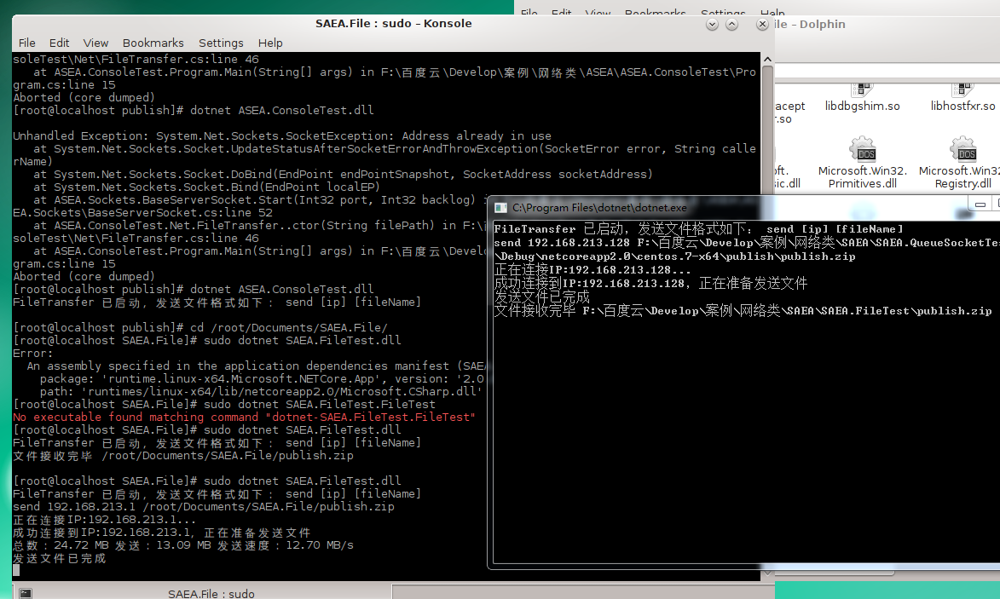
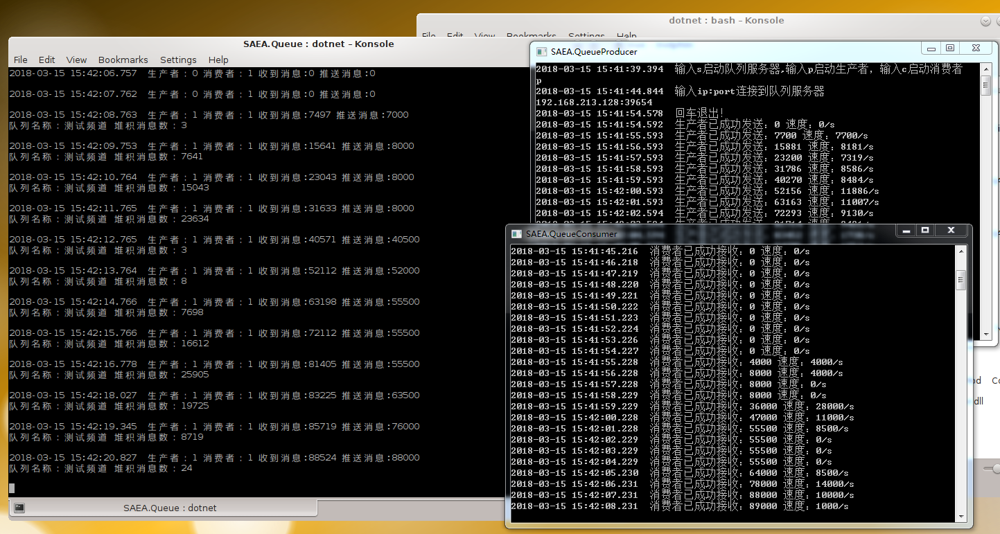
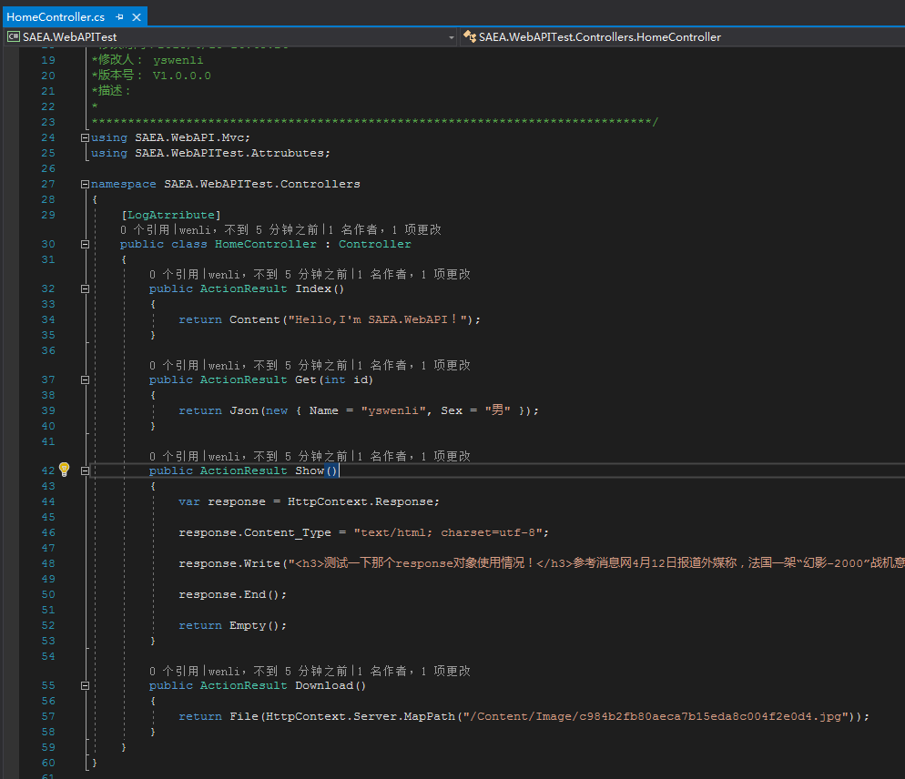
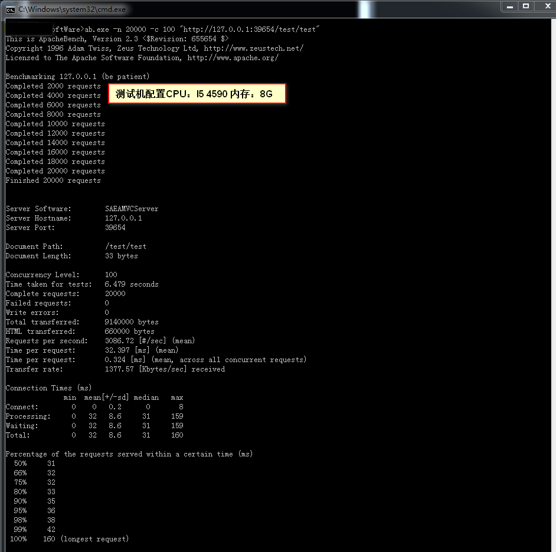
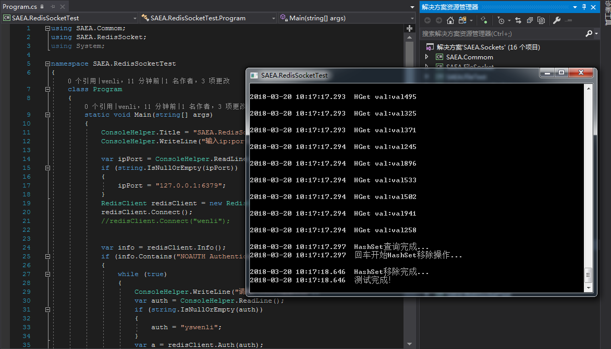
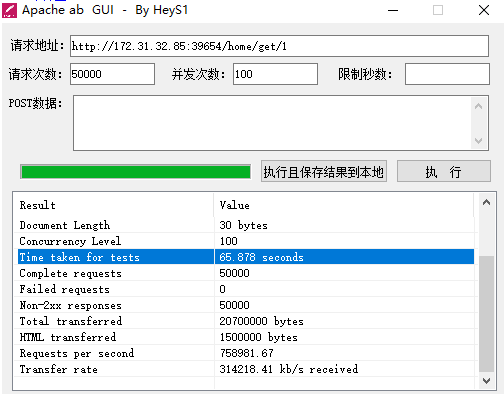
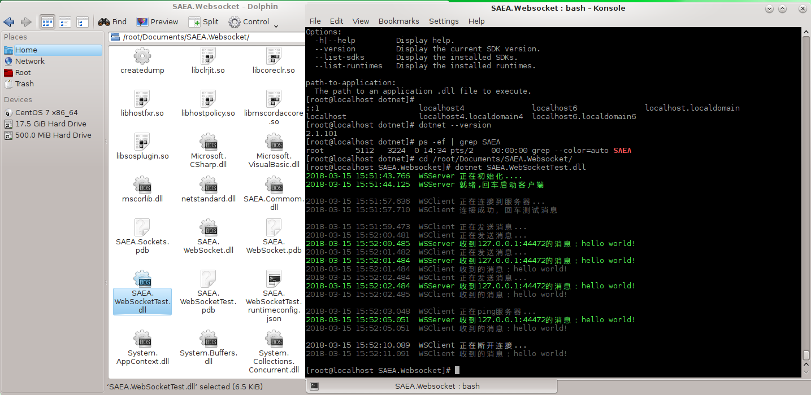
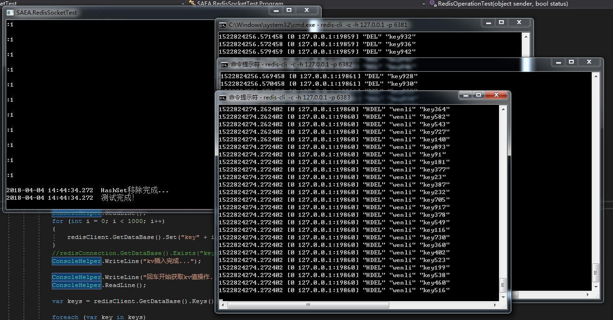
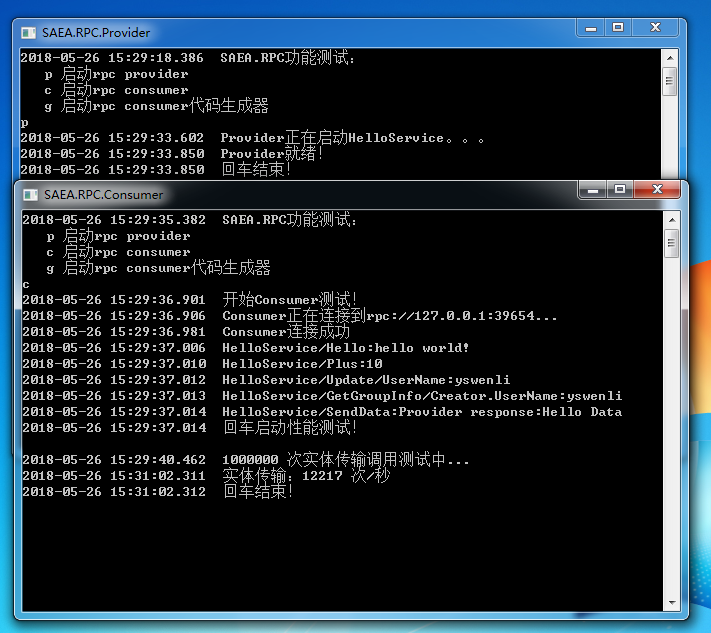

#  SAEA - 高性能网络通信框架家族 🚀

[](https://www.nuget.org/packages?q=saea)
[](https://www.apache.org/licenses/LICENSE-2.0.html)

**[English Version](README.en.md)** | **中文版**

> 基于 .NET Standard 2.0 的跨平台高性能网络通信框架，底层异步 IO 由 .NET 运行时按操作系统自动选择（Windows IOCP / Linux epoll / macOS kqueue）；收发路径统一为零拷贝（Span/Memory）+ 内存池化复用，提供完整的网络应用解决方案。

**SAEA.Socket** 是一个跨平台高性能 sockets 网络框架，Src 中包含其使用场景，例如大文件传输、WebSocket 客户端和服务器、高性能消息队列、RPC、Redis 驱动、HTTP Server、MQTT、MVC、DNS、消息服务器等。

---

## 快速导航 🧭

| 章节 | 内容 |
|------|------|
| [⚡ 30秒快速开始](#30秒快速开始) | 最简单的上手方式 |
| [🧩 组件导航](#组件导航) | 选择合适的组件 |
| [📐 项目架构](#项目架构) | 整体架构设计 |
| [✨ 核心特性](#核心特性) | 主要功能亮点 |
| [📊 实现与性能](#实现与性能) | 两种收发实现与实测数据说明 |
| [❓ 常见问题](#常见问题) | FAQ 快速解答 |
| [🔗 资源链接](#资源链接) | 更多学习资源 |

---

## 30秒快速开始 ⚡

### 方式 1: 安装核心 Socket 框架

```bash
dotnet add package SAEA.Sockets
```

```csharp
// 创建 TCP 服务器（仅需5行代码）
var server = SocketFactory.CreateServerSocket(
    SocketOptionBuilder.Instance.SetSocket(SAEASocketType.Tcp).UsePacket().SetPort(39654).Build()
);
server.OnServerReceiveSpan += (userToken, data) => server.Send(userToken.ID, data);
server.Start();
```

> 💡 `OnServerReceiveSpan` 的 `data` 为 `ReadOnlySpan<byte>`，仅在回调期间有效，请在同一次回调内同步消费（或 `ToArray()` 复制）。

### 方式 2: 选择适合你的组件

根据你的需求选择对应组件：

| 你的需求 | 推荐组件 | 安装命令 |
|----------|----------|----------|
| Web API 开发 | **SAEA.MVC** | `dotnet add package SAEA.MVC` |
| WebSocket 实时通信 | **SAEA.WebSocket** | `dotnet add package SAEA.WebSocket` |
| P2P 打洞与中继通信 | **SAEA.P2P** | `dotnet add package SAEA.P2P` |
| Redis 缓存操作 | **SAEA.RedisSocket** | `dotnet add package SAEA.RedisSocket` |
| 微服务 RPC | **SAEA.RPC** | `dotnet add package SAEA.RPC` |
| IoT 设备通信 | **SAEA.MQTT** | `dotnet add package SAEA.MQTT` |
| 文件传输 | **SAEA.FileSocket** | `dotnet add package SAEA.FileSocket` |

---

## 组件导航 🧩

### 核心组件

| 组件 | 功能 | NuGet | 中文文档 | 英文文档 | 适用场景 |
|------|------|-------|---------|---------|----------|
| 🔌 **SAEA.Sockets** | 跨平台高性能 Socket 通信框架 | [NuGet](https://www.nuget.org/packages/SAEA.Sockets) | [中文](Src/SAEA.Sockets/README.md) | [English](Src/SAEA.Sockets/README.en.md) | 游戏服务器、实时通信、IoT |
| 🔧 **SAEA.Common** | 通用工具类库 | [NuGet](https://www.nuget.org/packages/SAEA.Common) | [中文](Src/SAEA.Common/README.md) | [English](Src/SAEA.Common/README.en.md) | 序列化、缓存、加密 |
| 🧱 **SAEA.Sockets.Pipeline** | 双向通道链 + 可插拔分帧与两级编解码 | [NuGet](https://www.nuget.org/packages/SAEA.Sockets.Pipeline) | [中文](Src/SAEA.Sockets.Pipeline/README.md) | [English](Src/SAEA.Sockets.Pipeline/README.en.md) | 需要 Handler 链、鉴权、超时与背压的协议服务端 |

证书生成与格式转换：`Src/SAEA.Sockets.SslTlsTool`（支持 openssl 兼容子命令）。

### Web 应用组件

| 组件 | 功能 | NuGet | 中文文档 | 英文文档 | 适用场景 |
|------|------|-------|---------|---------|----------|
| 🌐 **SAEA.Http** | HTTP 服务器 | [NuGet](https://www.nuget.org/packages/SAEA.Http) | [中文](Src/SAEA.Http/README.md) | [English](Src/SAEA.Http/README.en.md) | RESTful API、静态文件服务 |
| 🎨 **SAEA.MVC** | MVC Web 框架 | [NuGet](https://www.nuget.org/packages/SAEA.MVC) | [中文](Src/SAEA.MVC/README.md) | [English](Src/SAEA.MVC/README.en.md) | Web 应用、API 服务 |

### 实时通信组件

| 组件 | 功能 | NuGet | 中文文档 | 英文文档 | 适用场景 |
|------|------|-------|---------|---------|----------|
| 💬 **SAEA.WebSocket** | WebSocket 服务器/客户端 | [NuGet](https://www.nuget.org/packages/SAEA.WebSocket) | [中文](Src/SAEA.WebSocket/README.md) | [English](Src/SAEA.WebSocket/README.en.md) | 实时聊天、推送通知 |
| 🤖 **SAEA.MQTT** | MQTT 协议实现 | [NuGet](https://www.nuget.org/packages/SAEA.MQTT) | [中文](Src/SAEA.MQTT/README.md) | [English](Src/SAEA.MQTT/README.en.md) | IoT 设备、智能家居 |
| 📨 **SAEA.MessageSocket** | 消息服务器 | [NuGet](https://www.nuget.org/packages/SAEA.MessageSocket) | [中文](Src/SAEA.MessageSocket/README.md) | [English](Src/SAEA.MessageSocket/README.en.md) | 即时通讯、在线客服 |

### P2P 通信组件

| 组件 | 功能 | NuGet | 中文文档 | 英文文档 | 适用场景 |
|------|------|-------|---------|---------|----------|
| 🔗 **SAEA.P2P** | ICE 式打洞 + 自研 STUN/TURN 中继组件 | [NuGet](https://www.nuget.org/packages/SAEA.P2P) | [中文](Src/SAEA.P2P/README.md) | [English](Src/SAEA.P2P/README.en.md) | NAT 穿越直连、TURN 中继回退、局域网发现、即时通讯、游戏对战 |

### 数据与存储组件

| 组件 | 功能 | NuGet | 中文文档 | 英文文档 | 适用场景 |
|------|------|-------|---------|---------|----------|
| 📦 **SAEA.RedisSocket** | Redis 客户端 | [NuGet](https://www.nuget.org/packages/SAEA.RedisSocket) | [中文](Src/SAEA.RedisSocket/README.md) | [English](Src/SAEA.RedisSocket/README.en.md) | Redis 缓存、分布式锁 |
| 📁 **SAEA.FileSocket** | 文件传输组件 | [NuGet](https://www.nuget.org/packages/SAEA.FileSocket) | [中文](Src/SAEA.FileSocket/README.md) | [English](Src/SAEA.FileSocket/README.en.md) | 大文件传输、断点续传 |
| 🗂️ **SAEA.FTP** | FTP 服务器/客户端 | [NuGet](https://www.nuget.org/packages/SAEA.FTP) | [中文](Src/SAEA.FTP/README.md) | [English](Src/SAEA.FTP/README.en.md) | 文件服务器、FTP 客户端 |

### 分布式系统组件

| 组件 | 功能 | NuGet | 中文文档 | 英文文档 | 适用场景 |
|------|------|-------|---------|---------|----------|
| 🔗 **SAEA.RPC** | RPC 远程调用 | [NuGet](https://www.nuget.org/packages/SAEA.RPC) | [中文](Src/SAEA.RPC/README.md) | [English](Src/SAEA.RPC/README.en.md) | 微服务通信、远程调用 |
| 📊 **SAEA.QueueSocket** | 内存消息队列 | [NuGet](https://www.nuget.org/packages/SAEA.QueueSocket) | [中文](Src/SAEA.QueueSocket/README.md) | [English](Src/SAEA.QueueSocket/README.en.md) | Pub/Sub、事件通知 |

### 网络工具组件

| 组件 | 功能 | NuGet | 中文文档 | 英文文档 | 适用场景 |
|------|------|-------|---------|---------|----------|
| 🌍 **SAEA.DNS** | DNS 服务器/客户端 | [NuGet](https://www.nuget.org/packages/SAEA.DNS) | [中文](Src/SAEA.DNS/README.md) | [English](Src/SAEA.DNS/README.en.md) | DNS 代理、域名解析 |
| 🔀 **SAEA.Socket5** | SOCKS5 代理服务器/客户端 | [NuGet](https://www.nuget.org/packages/SAEA.Socket5) | [中文](Src/SAEA.Socket5/README.md) | [English](Src/SAEA.Socket5/README.en.md) | 正向代理、内网穿透、UDP 转发 |

---

## 项目架构 📐

### SAEA 组件家族架构图

```
┌─────────────────────────────────────────────────────────────────┐
│                    SAEA 组件家族架构总览                          │
├─────────────────────────────────────────────────────────────────┤
│                                                                 │
│   ┌───────────── 应用层组件 ─────────────┐                     │
│   │                                       │                     │
│   │  ┌─────────┐  ┌──────────┐           │                     │
│   │  │  MVC    │  │ WebSocket│           │                     │
│   │  │(Web框架)│  │(实时通信)│           │                     │
│   │  └────┬────┘  └────┬─────┘           │                     │
│   │       │            │                  │                     │
│   │  ┌────▼────┐  ┌───▼────┐  ┌─────────┐│                     │
│   │  │  RPC    │  │ MQTT   │  │ Message ││                     │
│   │  │(远程调用)│  │(IoT)  │  │ Socket  ││                     │
│   │  └────┬────┘  └───┬────┘  └────┬────┘│                     │
│   │       │           │            │      │                     │
│   │  ┌────▼────┐  ┌───▼────┐       │      │                     │
│   │  │  P2P    │  │ Redis  │       │      │                     │
│   │  │(NAT穿透)│  │(缓存)  │       │      │                     │
│   │  └────┬────┘  └───┬────┘       │      │                     │
│   │       │           │            │      │                     │
│   └─────────┼───────────┼────────────┼─────┘                     │
│             │           │            │                           │
│   ┌─────────▼───────────▼────────────▼─────┐                   │
│   │           SAEA.Sockets (核心层)         │                   │
│   │       跨平台高性能Socket 框架           │                   │
│   │  ┌──────────┐  ┌──────────┐  ┌──────┐ │                   │
│   │  │IocpSocket│  │StreamSock│  │UdpSock│ │                   │
│   │  │ (TCP)    │  │(流模式)  │  │ (UDP) │ │                   │
│   │  └──────────┘  └──────────┘  └──────┘ │                   │
│   │  ┌──────────────────────────────────┐ │                   │
│   │  │  BufferPool │ Session │  Coder   │ │                   │
│   │  │  (内存池)   │(会话)  │(编解码)  │ │                   │
│   │  └──────────────────────────────────┘ │                   │
│   └──────────────────┬────────────────────┘                   │
│                      │                                          │
│   ┌──────────────────▼────────────────────┐                   │
│   │         SAEA.Common (基础层)           │                   │
│   │       通用工具类库 (序列化/缓存/加密)    │                   │
│   │  ┌────────┐  ┌───────┐  ┌───────┐   │                   │
│   │  │Serialize│  │ Cache │  │Encrypt│   │                   │
│   │  │(序列化) │  │(缓存) │  │(加密) │   │                   │
│   │  └────────┘  └───────┘  └───────┘   │                   │
│   └───────────────────────────────────────┘                   │
│                                                                 │
└─────────────────────────────────────────────────────────────────┘
```

### 数据流架构图

```
客户端请求流程:

┌─────────┐      ┌──────────┐      ┌──────────┐
│ 客户端  │─────►│ Sockets  │─────►│  Coder   │
│ (TCP/UDP)│      │异步IO接收│      │  解码    │
└─────────┘      └──────────┘      └──────────┘
                                         │
                                         ▼
                    ┌────────────────────────────────┐
                    │    应用层处理（业务逻辑）        │
                    │  MVC / RPC / WebSocket / MQTT  │
                    └────────────────────────────────┘
                                         │
                                         ▼
                    ┌──────────┐      ┌──────────┐
                    │  Coder   │─────►│ Sockets  │─────► 客户端
                    │  编码    │      │异步IO发送│
                    └──────────┘      └──────────┘
```

---

## 核心特性 ✨

| 特性 | 说明 |
|------|------|
| 🚀 **跨平台异步 IO** | Windows/Linux/macOS 由 .NET 运行时自动选择 IOCP / epoll / kqueue，同一套 API |
| 📦 **零拷贝 + 内存池** | 收发路径统一 Span/Memory 零拷贝，BufferManager、UserTokenPool、MemoryPoolManager 池化复用，大幅减少 GC 压力 |
| 🔒 **SSL/TLS 加密** | Stream 模式支持安全连接 |
| 🌐 **IPv6 支持** | 完全兼容 IPv6 协议 |
| 🔄 **会话管理** | SessionManager 自动管理连接会话 |
| 🛠️ **自定义协议** | ICoder 接口支持灵活的协议编解码 |
| 🔗 **链式配置** | SocketOptionBuilder 简洁易用 |
| 📝 **完整组件** | MVC、WebSocket、RPC、Redis、MQTT 等全场景覆盖 |

---

## 实现与性能 📊

### 两种收发实现

| 实现 | 选择方式 | 适用场景 |
|------|----------|----------|
| `SocketAsyncEventArgs` 模式 | `.UsePacket()` | 高吞吐二进制协议、自定义帧、UDP（UDP 仅支持此模式） |
| Pipelines 流模式 | `.UseStream()` | 需要 SSL/TLS，或希望用 `GetStream()` 流式读写 |

两种实现都跨平台，底层 IO 机制由 .NET 运行时选择（Windows IOCP / Linux epoll / macOS kqueue）。`UsePacket()` 是 `SocketAsyncEventArgs` 收发实现的入口，不表示 Windows 限定。

### 上层组件的处理器链

`Http`、`WebSocket`、`FileSocket`、`RPC`、`QueueSocket`、`MessageSocket` 的接收与连接生命周期已改由 `SAEA.Sockets.Pipeline` 的处理器链承担，不再暴露 `OnMessage` / `OnDisconnected` / `OnErr` 一类事件。使用方通过 `ConfigurePipeline` 在建链前追加处理器：

```csharp
using SAEA.MessageSocket;
using SAEA.Sockets.Pipeline;

var server = new MessageServer(port: 39654);

// 每条连接建链时调用一次，参数是连接标识与尚未启动的处理器链
server.ConfigurePipeline = (channelId, pipeline) => pipeline.AddLast(new MyInboundHandler());
server.Start();
```

处理器继承 `InboundHandlerAdapter`，在 `ChannelReadAsync` 里消费解码后的消息，在 `ChannelInactiveAsync` 里处理断开，在 `ChannelExceptionCaughtAsync` 里观察链上异常；不消费的消息会被链尾回收。传输层异常仍统一汇入 `ExceptionCollector`。

装配回调必须在 `Start()` 或首次 `Connect()` 之前赋值，链启动后再赋值会抛 `InvalidOperationException`。RPC 消费者、`QueueSocket` 的 `Producer` 等构造期即建链的入口只能通过构造参数注入。

### 链路装配契约与编解码

- **启动期校验**：上层组件均开启链尾校验，`Start()` 时要求链上最后一个入站节点是 `ExceptionTerminalHandler`、出站前缀最右侧恰好有一个 `OutboundSerializingHandler`；不满足即启动失败并收口，不会带病运行。
- **配置按连接新建**：每条连接独立创建通道配置与分帧器实例，不跨连接复用；分帧器一旦引入连接级状态（如协议切换），共享实例会让多连接互相干扰。
- **原始字节出站**：需要绕过编码器直接写字节时走 `WriteAsync(new RawFrame(...))`，`SAEA.Http` 的 `SendRaw` 与 MVC 的 WebSocket 发送都走这条路径。
- **编解码入口**：MVC 侧 WebSocket 接收使用 `WSCoder.Decode(byte[])` 重载，避免按消息整段复制；`ICoder.Decode(ReadOnlySequence<byte>)` 保留给其他调用方。`SAEA.FTP` 的 `FTPCoder` 占位实现已删除，`SAEA.RedisSocket` 的 `RedisCoder` 仅作泛型约束，`Encode`/`Decode` 调用即抛 `NotSupportedException`。

### SAEA.RPC vs HTTP RPC

| 特性 | SAEA.RPC | HTTP RPC |
|------|----------|----------|
| **序列化** | Protobuf | JSON |
| **传输协议** | TCP | HTTP |
| **连接模式** | 长连接 | 短连接 |
| **并发模型** | 异步 IO | 阻塞 |
| **性能** | **高** | 中 |

### 零拷贝收发路径（实测）

`SAEA.Sockets` 的 span 收包路径在同一收发基准下，相较旧解码路径显著降低分配与 GC：

| 路径 | 吞吐 | 分配 | GC0 |
|------|------|------|-----|
| 旧路径 `LegacyDecode` | 42,345 帧/秒 | 4,662 B/帧 | 18 |
| 零拷贝 `SpanDecodeStream` | 45,344 帧/秒 | **34 B/帧** | **0** |

> 数据来自 `SAEA.P2PTest --bench-iocp`（4KB 帧，单机回环，数值随硬件波动）。

> 本 README 不提供跨框架性能对比数字（与 TouchSocket、DotNetty 等的差异请以自己场景的压测为准）。

### 整栈实测（HTTP / WebSocket）

`SAEA.MVC` 装配在 `SAEA.Http` 与 `SAEA.Sockets` 之上的整栈压测，单机同进程、单次快照：

| 场景 | 结果 |
|---|---:|
| HTTP 串行（5000 次，短连接） | 943 RPS |
| HTTP 并发 16（10s） | 4140 RPS |
| HTTP 并发 64（10s） | 3529 RPS |
| HTTPS 串行（2000 次，短连接） | 220 RPS |
| 静态 100KB 串行（命中内存缓存） | 529 RPS / 51.7 MiB/s |
| WebSocket 单连接回显 | 7078 条/秒 |

> 口径：客户端与服务端同机同进程、走 IPv4 回环；普通响应固定 `Connection: close`，每个请求都含 TCP 建连与断开，HTTPS 再叠加一次 TLS 握手，RPS 受建连成本主导；静态文件命中内存缓存，不代表首次磁盘读取与大文件路径。单次快照，同一探针跨轮波动 20%–35%（另一次复跑为 HTTP 串行 749 RPS、HTTPS 串行 183 RPS、静态串行 515 RPS、WebSocket 单连接 5782 条/秒），只能做同一轮内的相对比较。

> 完整数据、失败率与资源占用见 [MVC / TLS 验收记录](docs/superpowers/plans/2026-11-13-mvc-tls-acceptance.md)；组件级口径见 [SAEA.Http](Src/SAEA.Http/README.md) 与 [SAEA.MVC](Src/SAEA.MVC/README.md) 的实测小节。`SAEA.Http` 作为独立服务器未单独采集基准。

---

## 常见问题 ❓

### Q1: SAEA 适合什么项目？

**A**: SAEA 适合以下场景：
- 🎮 游戏服务器（实时对战、状态同步）
- 📊 实时数据推送（股票行情、体育比分）
- 🤖 IoT 设备通信（传感器数据上报）
- 💬 即时通讯（私聊、群聊、客服系统）
- 🔗 微服务通信（RPC 远程调用）
- 📁 大文件传输（断点续传、高速传输）
- 🌐 P2P 打洞与中继通信（ICE 式打洞、STUN/TURN 中继、局域网发现）

### Q2: 如何选择合适的组件？

**A**: 根据你的需求选择：

```
你的需求                      推荐组件
─────────────────────────────────────
Web API 开发              →  SAEA.MVC
实时聊天/推送             →  SAEA.WebSocket
P2P 打洞与中继通信        →  SAEA.P2P
IoT 设备通信              →  SAEA.MQTT
Redis 缓存操作            →  SAEA.RedisSocket
微服务 RPC                →  SAEA.RPC
文件传输                  →  SAEA.FileSocket
自定义协议                →  SAEA.Sockets
```

### Q3: 是否支持跨平台？

**A**: 基于 .NET Standard 2.0，Windows、Linux、macOS 使用同一套 API：

- ✅ Windows（底层 IOCP）
- ✅ Linux（底层 epoll）
- ✅ macOS（底层 kqueue）

底层机制由 .NET 运行时自动选择，代码无需条件编译或切换实现。`UsePacket()` 是 `SocketAsyncEventArgs` 收发实现的入口，不表示 Windows 限定。

### Q4: NuGet 如何安装？

**A**: 搜索 "SAEA" 或直接安装：

```bash
# Package Manager
Install-Package SAEA.Sockets -Version 26.9.21.1

# .NET CLI
dotnet add package SAEA.Sockets --version 26.9.21.1
```

[NuGet 地址](https://www.nuget.org/packages?q=saea)

### Q5: 如何快速上手？

**A**: 3 步快速开始：
1. 安装对应组件的 NuGet 包
2. 阅读组件 README 的 "30秒快速开始"
3. 查看完整示例代码

每个组件都有详细的使用示例和注释。

### Q6: 是否有示例项目？

**A**: Src 中包含多个测试项目，展示实际使用场景：
- `SAEA.Sockets.TcpTest` / `SAEA.Sockets.UdpTest` / `SAEA.Sockets.PipelineTest` - 三种收发模式的 Socket 示例
- `SAEA.WebSocketTest` - WebSocket 示例
- `SAEA.MVCTest` - MVC Web 应用示例
- `SAEA.RedisSocketTest` - Redis 操作示例
- `SAEA.RPCTest` - RPC 调用示例
- `SAEA.P2PTest` - STUN/TURN 服务端宿主 + P2P 客户端自测程序
- `SAEA.Sockets.SslTlsTool` - 开发用 SSL/TLS 证书生成与格式转换工具（支持 openssl 兼容子命令）

**单元测试工程**：`Src/*.Tests/` 下有 11 个 MSTest 工程，均不在 `Src/SAEA.Sockets.sln` 中，需按需单独运行，目标框架为 `net10.0`。示例命令：`dotnet test Src/SAEA.Common.Tests/SAEA.Common.Tests.csproj -c Release`

工程列表：`SAEA.Common.Tests`、`SAEA.MQTT.Tests`、`SAEA.FTP.Tests`、`SAEA.Http.Tests`、`SAEA.WebSocket.Tests`、`SAEA.FileSocket.Tests`、`SAEA.RPC.Tests`、`SAEA.QueueSocket.Tests`、`SAEA.MessageSocket.Tests`、`SAEA.P2P.Tests`（需 .NET 8 runtime）、`SAEA.MVC.Tests`。

---

## 实例截图 🖼️











---

## 资源链接 🔗

### 官方资源

- [GitHub 仓库](https://github.com/yswenli/SAEA)
- [NuGet 包列表](https://www.nuget.org/packages?q=saea)
- [作者博客](https://www.cnblogs.com/yswenli/)

### 相关项目

- [WebRedisManager](https://github.com/yswenli/WebRedisManager) - 基于 SAEA.RedisSocket 的 Redis 管理工具
- [SAEA.Rested](https://github.com/yswenli/SAEA.Rested) - 基于 SAEA.MVC 的 REST API 示例
- [GFF](https://github.com/yswenli/GFF) - 基于 SAEA 的仿 QQ 通信程序

### 技术支持

- QQ 群：788260487
- Issues：[GitHub Issues](https://github.com/yswenli/SAEA/issues)

---

## 许可证

Apache License 2.0